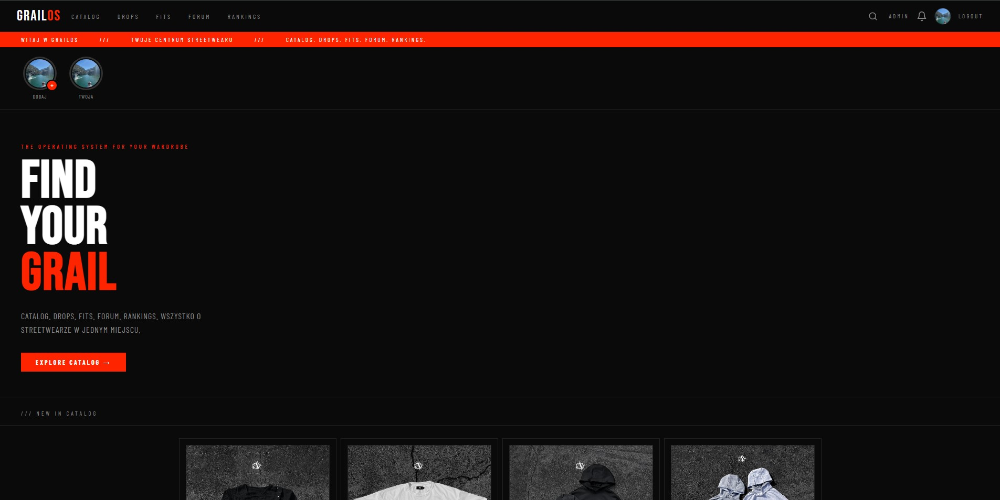
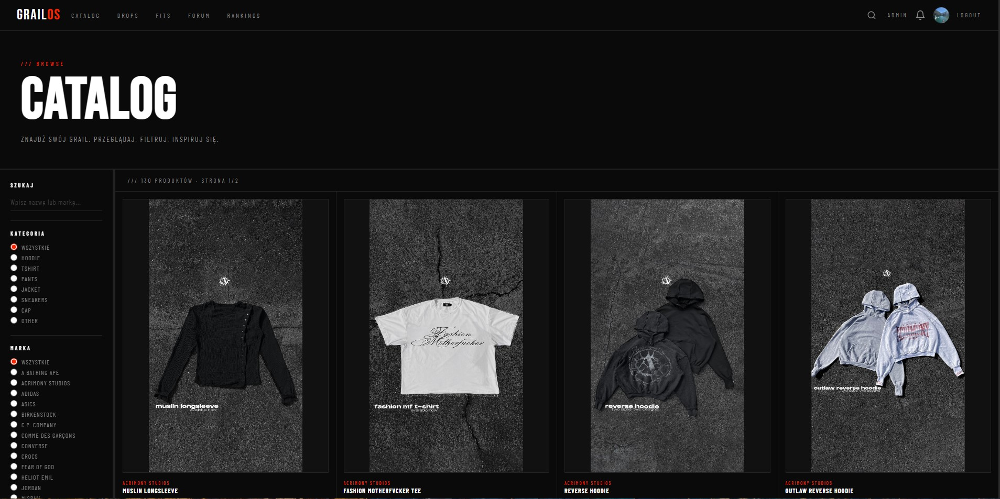
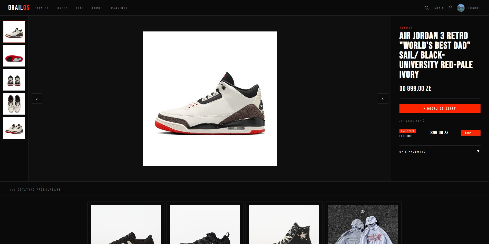
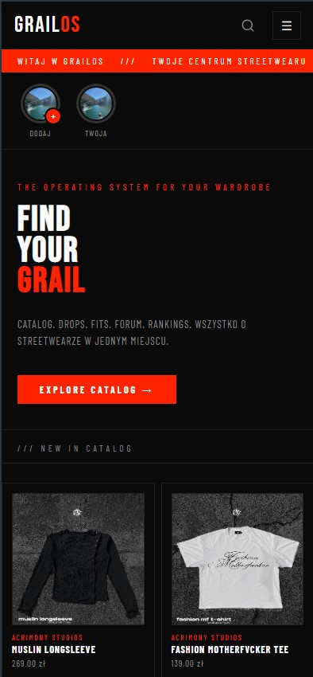
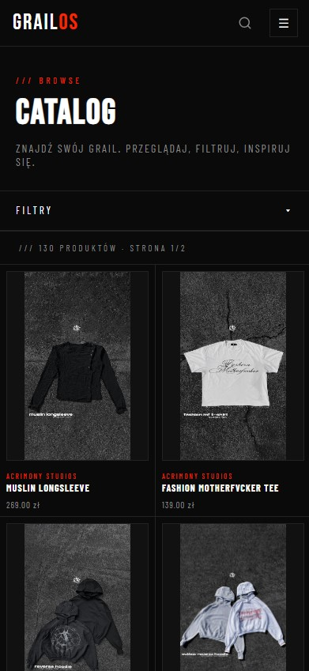

# 🏆 GrailOS

### Polska społeczność streetwear i sneakerheadów

Katalog ubrań i butów · dropy · fity · forum · stories

---

## 👋 O projekcie

**GrailOS** to samodzielnie zaprojektowana i napisana od zera platforma dla polskiej sceny streetwear i sneakerheadów. Projekt działa produkcyjnie pod adresem **[grailos.pl](https://grailos.pl)**.

Łączy w jednym miejscu katalog produktów z porównaniem sklepów, kalendarz premier oraz funkcje społecznościowe znane z popularnych serwisów, dopasowane do kultury resellerskiej.

Całość powstała **bez frameworków i bez systemu budowania**. To świadoma decyzja, żeby pokazać solidną znajomość podstaw: PHP, SQL, HTTP, bezpieczeństwa i pracy z przeglądarką.

---

## ✨ Co potrafi aplikacja

| | |
|---|---|
| 👟 **Katalog** | Ubrania i buty z porównaniem ofert z wielu sklepów oraz wyszukiwarką z podpowiedziami |
| 🔥 **Dropy** | Kalendarz premier, „hype" na dropy i powiadomienia e-mail |
| 📸 **Fity** | Outfity użytkowników z głosowaniem, komentarzami i odpowiedziami |
| 💬 **Forum** | Posty, kategorie, wątki odpowiedzi |
| ⏱️ **Stories 24h** | Edytor graficzny w przeglądarce (filtry, tekst, naklejki, gesty dotykowe, kadr 9:16) |
| 👤 **Profile** | Avatar, bio, szafa, outfity, obserwowani, ustawienia prywatności |
| 🔔 **Powiadomienia** | Dzwonek w nawigacji i osobna strona z historią aktywności |
| 🛠️ **Panel admina** | Moderacja treści, zgłoszenia, importy danych |

---

## 🧠 Wyzwania inżynierskie

Nad czym było najciekawiej pracować:

- **Import i deduplikacja danych produktowych** z różnych źródeł (CSV, feedy XML, scraping) do spójnego katalogu
- **Edytor stories w `<canvas>`** z obsługą gestów na urządzeniach mobilnych
- **System interakcji społecznościowych**: lajki, komentarze zagnieżdżone, obserwowanie i powiadomienia
- **SEO**: dynamiczne metadane, Open Graph, dane strukturalne i mapa strony
- **Prywatność i zgodność z RODO**: baner cookies zintegrowany z Google Consent Mode v2
- **Bezpieczeństwo aplikacji** budowane od podstaw, bez gotowego frameworka

---

## 🧰 Technologie

**Backend:** PHP 8 · PDO · MariaDB  
**Frontend:** HTML5 · CSS3 · JavaScript (vanilla) · Canvas API  
**Narzędzia:** Python · Playwright · Git · Apache · SMTP  
**Wdrożenie:** hosting współdzielony, domena produkcyjna, cron

---

## 🖼️ Zrzuty ekranu

<!-- Dodaj tutaj 3–4 screeny, np. w folderze docs/screenshots/ -->
<!--

  
  
  
  
  

-->

*Pełną wersję możesz zobaczyć na żywo: **[grailos.pl](https://grailos.pl)***

---

## 📬 Kontakt

**Tomasz Gorzelniowski** 
**GitHub:** [@tgorzelniowski](https://github.com/tgorzelniowski)
**Mail** : gorzelniowski59@gmail.com

---

## ⚖️ Licencja i prawa autorskie

© 2026 Tomasz Gorzelniowski. **Wszelkie prawa zastrzeżone.**

Kod źródłowy jest udostępniony wyłącznie w celach poglądowych (portfolio). Kopiowanie, modyfikowanie, uruchamianie we własnych projektach oraz dystrybucja kodu lub jego fragmentów bez pisemnej zgody autora jest zabronione.
